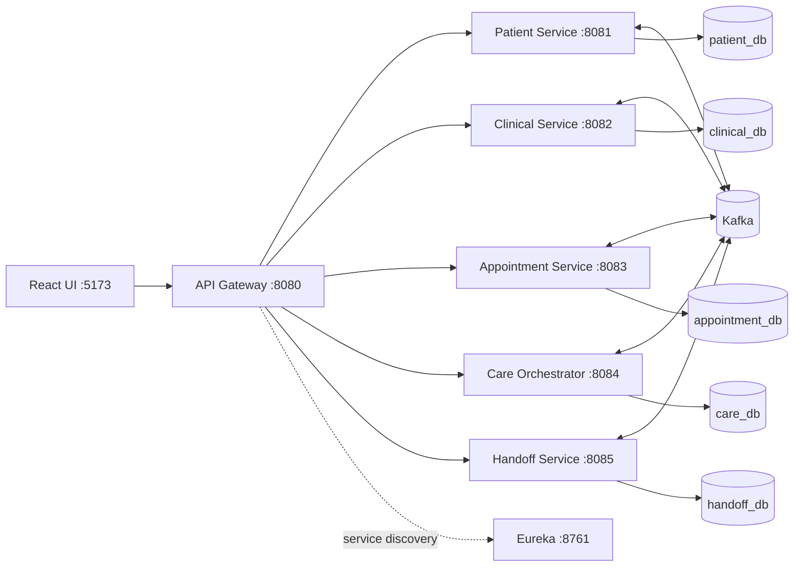

# MediSync

MediSync is an event-driven patient care continuity platform. It helps care teams
track clinical pathways, detect care gaps, and preserve context when a patient
moves between doctors or departments.

> **Educational prototype:** the project uses synthetic data only and is not
> intended for production healthcare use.

## What the project demonstrates

- **Care-gap detection:** identifies an unreviewed lab report, a missed
  follow-up, and the combined high-risk condition.
- **Patient journey timeline:** records important patient events in chronological
  order.
- **Clinical pathways:** tracks mandatory and optional steps for seeded pathways
  such as Diabetes Review and Post-Surgery Follow-up.
- **Doctor handoffs:** transfers open care gaps as pending items and requires
  acknowledgement by the receiving doctor.
- **Continuity verification:** an episode can close only after mandatory steps
  are complete, care gaps are resolved, and handoffs are acknowledged.

## Architecture



### Runtime components

| Component | Port | Responsibility |
|---|---:|---|
| React frontend | 5173 | Browser UI for the care-team workflows |
| API Gateway | 8080 | Single browser entry point, routing, JWT validation, and role checks |
| Eureka Server | 8761 | Service registry used by the gateway for discovery |
| Patient Service | 8081 | Patient records, users, login, and patient events |
| Clinical Service | 8082 | Lab orders, lab reports, and clinical notes |
| Appointment Service | 8083 | Booking, completion, and missed appointments |
| Care Orchestrator | 8084 | Episodes, pathways, care gaps, timeline, and continuity verification |
| Handoff Service | 8085 | Doctor handoffs, notifications, and a local care-gap projection |
| Kafka + ZooKeeper | 9092 | Asynchronous domain-event transport |
| Redis | 6379 | Provisioned for future caching; unused by the current application |

There are five business services. Eureka and the API Gateway are platform
services, so Docker Compose starts seven Spring applications in total.

## How the microservices work

Each business service owns one business capability and its own database. The
frontend calls only the gateway. The gateway uses Eureka service discovery to
route `/api` requests to the appropriate service. Business services do not
make synchronous HTTP calls to one another; they publish and consume Kafka
events instead.

Events use the shared `DomainEvent` contract from `backend/common`, are
serialized as JSON, and are keyed by `patientId`. This keeps patient-related
events ordered within a Kafka partition while allowing services to evolve
independently.

| Kafka topic | Producer | Events | Consumers |
|---|---|---|---|
| `medisync.patient.events` | Patient Service | `PATIENT_REGISTERED` | Care Orchestrator |
| `medisync.clinical.events` | Clinical Service | `LAB_ORDERED`, `LAB_REPORT_UPLOADED`, `LAB_REPORT_REVIEWED`, `CLINICAL_NOTE_ADDED` | Care Orchestrator, Handoff Service |
| `medisync.appointment.events` | Appointment Service | `APPOINTMENT_BOOKED`, `APPOINTMENT_COMPLETED`, `APPOINTMENT_MISSED` | Care Orchestrator, Handoff Service |
| `medisync.handoff.events` | Handoff Service | `HANDOFF_CREATED`, `HANDOFF_ACKNOWLEDGED` | Care Orchestrator |
| `medisync.care.events` | Care Orchestrator | `CARE_GAP_DETECTED`, `CARE_GAP_RESOLVED`, `CARE_GAP_ESCALATED`, `EPISODE_CLOSED` | Handoff Service |

For example, uploading a lab report writes to the clinical database and emits
`LAB_REPORT_UPLOADED`. The Care Orchestrator consumes that event, records it in
the timeline, and opens a `LAB_REPORT_UNREVIEWED` gap. No service needs to query
the clinical database directly.

## Database design

MediSync uses PostgreSQL 16 with database-per-service ownership. The databases
are separate Docker containers and volumes, and each service runs its own
Flyway migrations. JPA schema auto-generation is disabled
(`ddl-auto: none`), so the SQL migrations are the source of truth.

| Database | Port | Owner | Main tables and data |
|---|---:|---|---|
| `patient_db` | 5441 | Patient Service | `patients`, `app_users` |
| `clinical_db` | 5442 | Clinical Service | `lab_orders`, `lab_reports`, `clinical_notes` |
| `appointment_db` | 5443 | Appointment Service | `appointments` |
| `care_db` | 5444 | Care Orchestrator | `timeline_events`, `care_gaps`, `pathways`, `pathway_steps`, `care_episodes`, `episode_steps` |
| `handoff_db` | 5445 | Handoff Service | `handoffs`, `handoff_items`, `notifications`, `known_gaps` |

The services intentionally do not share tables or foreign keys across database
boundaries. Fields such as `patient_id` and `reference_id` are identifiers
carried in commands and events, not cross-database relationships. The Handoff
Service's `known_gaps` table is a local projection built from care-gap events;
it is not a second source of truth. Care gaps remain owned by the Care
Orchestrator.

This design provides clear ownership and allows each service to scale or change
its schema independently. It also means this prototype does not provide a
single cross-service transaction. Events are published after the local save,
so a production implementation should use a transactional outbox and stronger
service-to-service authentication.

## Care-gap and pathway rules

| Gap | Opened when | Resolved when |
|---|---|---|
| `LAB_REPORT_UNREVIEWED` | A lab report is uploaded | That report is reviewed by a doctor |
| `MISSED_FOLLOWUP` | A follow-up appointment is missed | A replacement appointment is booked |
| `COMBINED` (`CRITICAL`) | Both gaps are open for the patient | Either contributing gap is resolved |
| Escalation | Any open gap exceeds `GAP_ESCALATION_MINUTES` | The gap severity is changed to `CRITICAL` |

The demo default is two minutes; the scheduled scanner runs every 30 seconds.
Starting a pathway creates an episode and copies its steps into
`episode_steps`. Matching events complete steps automatically. The optional
clinical-note step does not block closure.

## Security

`POST /api/auth/login` is handled by the Patient Service and returns an HS256
JWT. The API Gateway validates the token, applies the role matrix, and
overwrites forwarded `X-User-Name` and `X-User-Role` headers. The services are
not exposed to the browser and trust the gateway in this prototype.

| Role | Main capabilities |
|---|---|
| `ADMIN` | Everything |
| `DOCTOR` | Labs, reports, notes, pathways, handoffs, and appointments |
| `NURSE` | Notes, appointments, pathway read/start, care gaps, and handoffs |
| `LAB_TECHNICIAN` | Upload reports and view clinical data |
| `RECEPTIONIST` | Register patients and manage appointments |

Seeded users all use the password `Password@123`:
`admin`, `dr.smith`, `dr.jones`, `nurse.kim`, `lab.tech`, `reception`.

## Run on Windows

### Prerequisites

- Docker Desktop with the WSL2 backend and at least 6 GB assigned to Docker
- Node.js 18 or newer
- PowerShell 5 or newer

### Start the backend

```powershell
cd medisync
docker compose up -d --build
docker compose ps
```

Wait for the services to become healthy. Eureka is available at
<http://localhost:8761>. The first build downloads Maven dependencies and may
take several minutes.

### Start the frontend

```powershell
cd frontend
npm install
npm run dev
```

Open <http://localhost:5173> and sign in as `dr.smith` with
`Password@123`.

### Run the scripted demo

```powershell
.\scripts\demo-flow.ps1
```

If PowerShell blocks unsigned local scripts:

```powershell
powershell -ExecutionPolicy Bypass -File .\scripts\demo-flow.ps1
```

The script starts a Diabetes Review episode, orders and uploads an HbA1c report,
creates care gaps, creates a handoff, demonstrates a failed verification, then
resolves the work and closes the episode.

### Stop or reset

```powershell
docker compose down        # stop containers and keep database volumes
docker compose down -v     # stop containers and delete all five databases
```

### Ports

| Service | Port |
|---|---:|
| Frontend | 5173 |
| API Gateway | 8080 |
| Patient, Clinical, Appointment, Care, Handoff | 8081-8085 |
| Eureka | 8761 |
| Kafka (host / Docker network) | 9092 / 29092 |
| PostgreSQL databases | 5441-5445 |
| Redis | 6379 |

Database username and password are `medisync` for local development.

### Run services from an IDE

Start infrastructure without the Spring applications:

```powershell
docker compose up -d patient-db clinical-db appointment-db care-db handoff-db zookeeper kafka
cd backend
mvn clean install -DskipTests
```

Then run `EurekaServerApplication` first, followed by the gateway and business
application classes. The default `application.yml` files point to localhost.
Use JDK 21 and Maven 3.9 or newer.

## Faculty demo flow

1. Sign in as `dr.smith`, open patient 1, and start **Diabetes Review Pathway**.
2. Order an **HbA1c** lab. Sign in as `lab.tech` and upload an abnormal report.
3. Return as `dr.smith` and observe `LAB_REPORT_UNREVIEWED`.
4. Sign in as `reception`, book a follow-up, and mark it missed.
5. Observe `MISSED_FOLLOWUP` and the critical `COMBINED` gap.
6. Create a handoff to `dr.jones`; open gaps become pending handoff items.
7. Verify the episode and observe the failed result with missing steps, gaps, and
   an unacknowledged handoff.
8. Review the report, rebook and complete the appointment, and acknowledge the
   handoff as `dr.jones`.
9. Verify again, close the episode, and inspect the patient journey timeline.

To watch event processing:

```powershell
docker compose logs -f care-orchestrator-service handoff-service
```

## API summary

All endpoints are accessed through `http://localhost:8080`.

| Area | Endpoints |
|---|---|
| Auth | `POST /api/auth/login`, `GET /api/auth/users?role=DOCTOR` |
| Patients | `POST/GET /api/patients`, `GET/PUT/DELETE /api/patients/{id}` |
| Clinical | `POST/GET /api/clinical/lab-orders`, `POST/GET /api/clinical/lab-reports`, `POST /api/clinical/lab-reports/{id}/review`, `POST/GET /api/clinical/notes` |
| Appointments | `POST/GET /api/appointments`, `POST /api/appointments/{id}/complete`, `POST /api/appointments/{id}/missed` |
| Care | `GET /api/care/timeline/{patientId}`, `GET /api/care/gaps`, `GET /api/care/pathways`, `POST/GET /api/care/episodes`, `GET /api/care/episodes/{id}/verify`, `POST /api/care/episodes/{id}/close` |
| Handoffs | `POST/GET /api/handoffs`, `POST /api/handoffs/{id}/acknowledge`, `GET /api/handoffs/suggested-items?patientId=` |
| Notifications | `GET /api/notifications`, `POST /api/notifications/{id}/read` |

## Project layout

```text
medisync/
  docker-compose.yml
  backend/
    pom.xml
    common/                         Shared event and security utilities
    eureka-server/                  Service registry
    api-gateway/                    Gateway, JWT filter, and role rules
    patient-service/                Patient and user data
    clinical-service/               Labs and clinical notes
    appointment-service/            Appointments
    care-orchestrator-service/      Pathways, episodes, gaps, and timeline
    handoff-service/                Handoffs and notifications
  frontend/                         React, Vite, Tailwind, Axios, React Router
  scripts/demo-flow.ps1             End-to-end API demonstration
```

## Known limitations and production improvements

- Events are published after the local save rather than through a transactional
  outbox. A crash between those operations can lose an event.
- Care-service consumers de-duplicate events by `eventId`, making Kafka
  redelivery safe for the current flows.
- JWT and role enforcement are gateway-centric. Production should also use
  service-level token validation and mTLS.
- Services do not perform cross-service existence checks for identifiers such as
  `patient_id`.
- Redis is currently unused and is included for future caching or token
  blacklist support.
- Controllers return entities directly in this prototype; a production API
  should use dedicated response DTOs.
- Replace the demo JWT secret and database passwords before any deployment.
